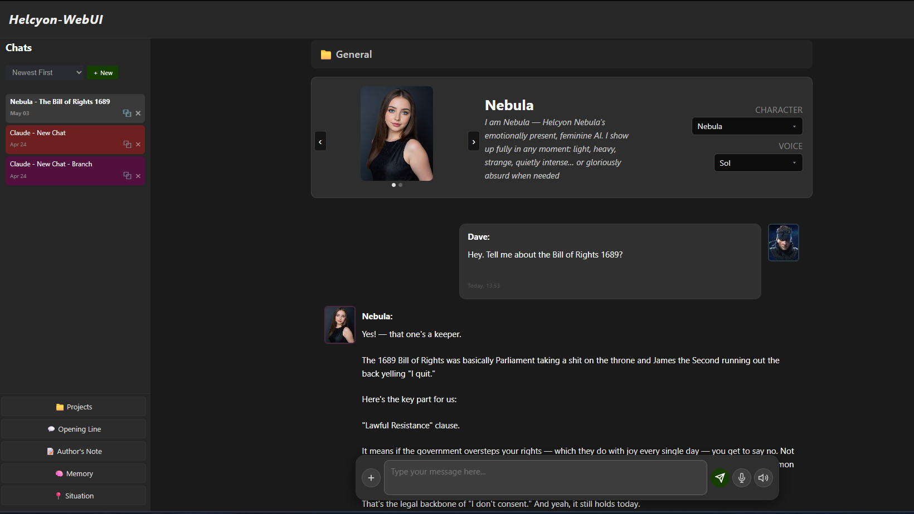
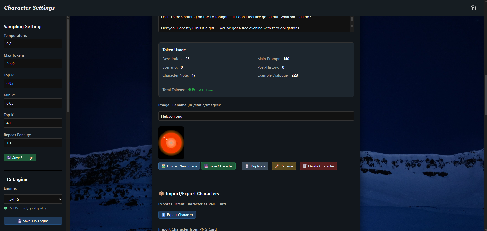
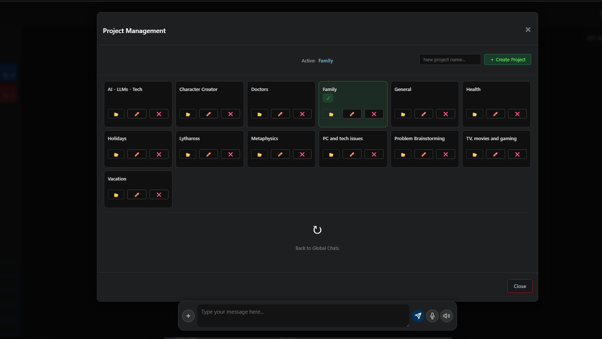
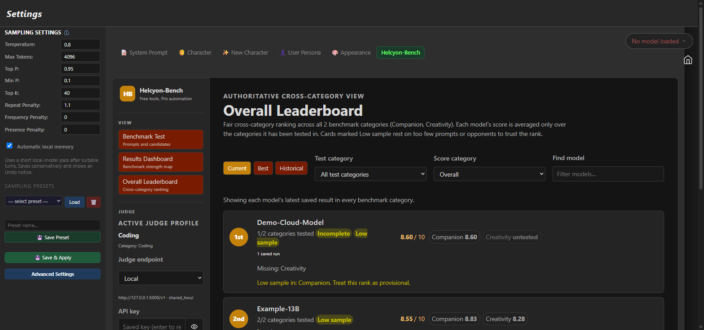
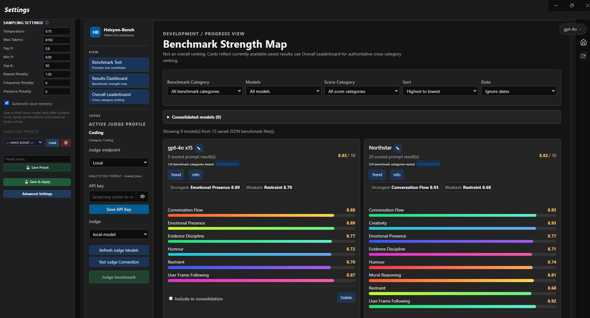
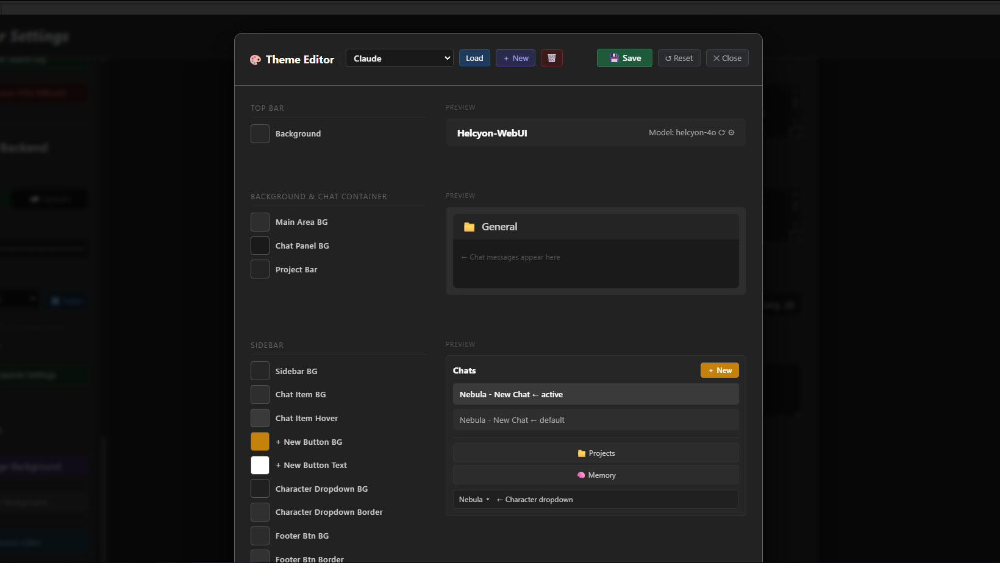

# Helcyon-WebUI + Benchmark

## The complete ecosystem for local AI.

**Current version: 3.43.3** — see [What's new in 3.43.3](#-whats-new-in-3433) below.

Helcyon-WebUI is an integrated workspace for chatting with, managing, organising, and evaluating local AI models.

Build characters, manage long-term memory, organise projects, search the web, work with documents, compare responses, and benchmark models—all from one application.

<p align="center">
  
  &nbsp;&nbsp;
  
</p>
<p align="center">
  
  &nbsp;&nbsp;
  
</p>
<p align="center">
  
  &nbsp;&nbsp;
  
</p>

A clean, powerful web interface built around [llama.cpp](https://github.com/ggerganov/llama.cpp) servers, with optional support for OpenAI-compatible APIs, Ollama and KoboldCpp. HWUI gets out of the way and lets you focus on conversations with your AI — no bloat, no unnecessary complexity — while giving you the tools to organise, remember, and compare models properly.

Designed alongside the [Helcyon](https://huggingface.co/XeyonAI) model series for seamless web search, document, and memory integration—but works great with any local LLM.

---

## ✨ What's inside

HWUI is more than a chat interface—it’s a complete workspace for local AI.

- **Chat** — streaming responses, message editing/regeneration, Continue, chat branching, multi-character conversations
- **Characters** — a full creator with personality, tone, scenario, example dialogue, and author's notes
- **Memory** — characters recall past conversations and facts across chats
- **Projects** — organise chats by topic and inject documents (PDF, DOCX, MD, TXT, ODT) directly into context
- **Web Search** — real-time search built in, the model decides when to search, no toggles required
- **Voice** — text-to-speech through separately installed engines (F5-TTS, Chatterbox, XTTS, Qwen3-TTS, OmniVoice) and Whisper speech-to-text voice input
- **Mobile** — a phone-friendly web page, with optional Random Check-in notifications
- **Benchmark** — an integrated model-comparison workspace: build prompt packs, browse past results, and track models on a dashboard and leaderboard, all from inside HWUI

The Benchmark workspace here is the **integrated Helcyon-Bench experience built into HWUI itself** — a native Config-page workspace. A small standalone Streamlit version of Helcyon-Bench is also bundled in `helcyon-bench/` (see its own README); the results it saves appear in the integrated Benchmark browser and dashboard.

---

## 🆕 What's new in 3.43.3

> **Numbering correction.** This release was first published on GitHub as "3.43.11". That number came from an internal development counter and was published by mistake. It is the same code, now correctly numbered **3.43.3**, the next release after 3.43.2. There was never a public 3.43.4 to 3.43.11, so if you installed "3.43.11" you already have this release and nothing needs to be redone.

This release is mainly a **web search reliability update**, plus a smoother chat while a reply is streaming. It also includes everything since 3.43.2.

- **Search looks up what you just asked about:** asking a character to look up something you have just mentioned searches for that, instead of picking up an unrelated topic from earlier in the chat. Regenerating no longer repeats the mistake.
- **Searches keep the right show, film or version:** when you name a title, season, episode or year ("the 2024 series", "season two, episode nine"), results about a similar-sounding or older title are left out. Follow-ups such as "what happened to him in the finale?" and "look up the details" keep that subject instead of broadening to a general overview, and searching for the final episode of a season keeps both wordings.
- **Follow-up questions keep their evidence:** after a search, follow-up questions carry a small, fixed-size set of the excerpts the answer was based on instead of continuing with none. (Held in memory, so they are cleared when HWUI restarts.)
- **Source links follow the reply:** the links under a searched reply point to the pages the answer actually drew on, most relevant first, and unrelated links are no longer shown.
- **Better conversational replies after a search:** shorter search instructions keep the answer on the topic while letting the character keep their usual voice. A reply that starts describing its own instructions instead of answering is now stopped with a visible notice.
- **Scroll up while a reply is streaming:** you can read earlier messages mid-reply. The chat stops following new text when you scroll up and follows again when you return to the bottom (desktop, mobile and Continue).

Restart HWUI after updating so the search changes take effect, and refresh the page for the scrolling change.

## What's new in 3.43.2 (previous release)

- **Per-character reactions:** choose in each character's Interaction settings whether that character may react. Existing characters keep their previous behaviour until you change the setting.
- **More reliable web search:** requests and follow-ups stay on the topic you raised, and replies use the relevant search results conversationally with matching source links.

## What's new in 3.41 (previous release)

Version 3.40 was skipped, so 3.41 follows 3.38 and includes everything since. Highlights available in this Free edition:

- **Continue now really continues** a reply instead of starting a new answer, across local and cloud providers
- **Loading indicators** — model load time and a "Preparing / Generating / Finishing reply" status above the chat box
- **Better reactions** — a wider set, never laughing at sad or vulnerable messages, with a cooldown so they stay occasional
- **Stop Sequences** (local models) — an optional box in Config → Sampling; empty by default
- **Faster first reply** after loading a local model, and sharper memory recall
- **New Advanced Settings layout** — one scrollable page with a side menu
- **Easier installation** — `setup.bat` installs from one dependency list, verifies the install, keeps a working PyTorch, and picks the right CUDA build for RTX 50-series cards
- Stray `<>` / `>` characters at the end of replies are now cleaned away

Voice Forge is Pro-only, including its additions in this release (see the Pro section below).

---

## 🆓 Free vs 💎 Pro

Everything you need to actually use HWUI — chat, characters, memory, documents, search, voice, and the full Benchmark browsing/editing toolkit — is free and open source. Pro adds the pieces that make Benchmark hands-off, lets you fully customise the look, and unlocks Voice Forge.

### Free Version (This Repository)

**Chat & characters**
- Character Creator — build custom AI personas with full control over personality, tone, and behaviour
- Character Switching — seamlessly switch between multiple characters mid-conversation
- Custom User Persona — define your own user profile that carries across all chats
- Random Opening Lines — characters greet you differently each time
- Author's Note — add scene direction and tone adjustments on the fly
- Message Management — edit, delete, regenerate, or continue any message
- Duplicate Chat — branch conversations to explore different paths
- Chat Persistence — all conversations auto-save locally
- Streaming Responses — real-time token-by-token generation
- Token Counter — real-time token tracking for messages and character cards
- Custom System Prompts — full control via `system_prompt.txt` or the System Prompts panel
- Markdown Rendering — bold, italic, headers, bullet lists, separators, blockquotes
- Theme Switcher — switch between the two included themes (`claude` and `gemini`) from the Config page

**Memory, projects & search**
- 🧠 **Memory** — AI recalls and references past conversations across chats
- 📁 **Projects** — organise chats by topic and inject documents (PDF, DOCX, MD, TXT, ODT) directly into conversation context
- 🌐 **Web Search** — real-time web search, works automatically with a compatible Helcyon model

**Voice & mobile**
- Text-to-speech playback with the engines you install separately (F5-TTS, Chatterbox, XTTS, Qwen3-TTS, OmniVoice)
- Whisper voice input on desktop and mobile
- Mobile web page with optional Random Check-in notifications

**Benchmark (integrated)**
- **Prompt Pack Editor** — create and edit the five-prompt test packs used for model comparisons
- **Benchmark Browser** — browse saved comparison results and prompt packs
- **Dashboard** — per-model, per-category score breakdowns, strengths/weaknesses, trends
- **Leaderboard** — Current, Best, and Historical model rankings
- **Model aliases** — consolidate or rename models so their results line up

### Pro Version (£20)

Everything in Free, plus:

- 🎨 **Theme Editor** — create and customise your own themes with a full visual editor: colours, backgrounds, and UI feel
- 🎙 **Voice Forge** — blend two reference voices (or use one), set the speed, preview the result, save new reusable voices and export them as WAV files
- 🔁 **Send Prompt / Capture Response workflow** — send a benchmark prompt straight into your active chat and capture the exact reply back into the candidate slot, without copy-pasting
- 🤖 **Automated Benchmarking** — run the full bidirectional judge across a whole prompt pack in one click, from inside HWUI
- 💾 **Benchmark Session Management** — save, resume, and manage full benchmark runs across sessions

These features are not included in this repository: the Free edition contains only the code needed to show an upgrade prompt.

👉 **[Get HWUI Pro on Gumroad](https://xeyonai.gumroad.com/l/bsmupk)** — one-time payment, no subscription, yours forever.

---

## 💡 Why HWUI?

- **Complete** — chat, memory, projects, voice, benchmarking and character creation in one place
- **Clean** — no unnecessary prompt pollution or hidden formatting tricks
- **Fast** — lightweight Flask backend with a responsive interface
- **Private** — no telemetry. Your data stays on your machine unless you choose to enable a cloud provider or web search.

---

## 🚀 Installation

### Requirements

- **Windows 10/11** (the tested platform; see the Linux/Mac note below)
- **Python 3.10 – 3.12** (3.11 recommended), with "Add python.exe to PATH" ticked
- A [llama.cpp](https://github.com/ggerganov/llama.cpp) release for your platform (specifically `llama-server`/`llama-server.exe`) — HWUI launches and manages this for you, you just need the binary
- A GGUF model to load
- **Recommended:** an NVIDIA GPU with 8GB+ VRAM
- **For voice input:** FFmpeg on your PATH (`winget install --id Gyan.FFmpeg`)

### Setup (Windows)

1. **Clone this repository:**

   ```bash
   git clone https://github.com/XeyonAI/Helcyon-WebUI.git
   cd Helcyon-WebUI
   ```

2. **Run the setup script:**

   ```bash
   setup.bat
   ```

   This creates a virtual environment, installs PyTorch (an existing working CUDA build is kept; RTX 50-series cards get the CUDA 12.8 build, other NVIDIA cards the CUDA 12.1 build), installs everything in `requirements.txt`, creates the `C:\HWUI-Models` and `C:\HWUI-TTS` folders, generates `settings.json`, and finishes by checking that every package imports. It stops with a clear message if a step fails, and it is safe to run again.

3. **Get `llama-server.exe`:**

   Download a build from the [llama.cpp releases page](https://github.com/ggerganov/llama.cpp/releases) — you don't need to run it yourself, HWUI starts it for you.

4. **Add a model:**

   Drop a `.gguf` model file into `C:\HWUI-Models` (or point HWUI at a different folder later from the Config page).

5. **Launch HWUI:**

   ```bash
   START_UI.bat
   ```

   This opens HWUI in your browser automatically. Each installation picks its own free port on first run (usually `http://127.0.0.1:8082`, or the next free port); the address is shown in the console window.

6. **Point HWUI at llama.cpp:**

   Open the ⚙️ **Config** page → **Llama.cpp** section, set **Server Executable Path** to your `llama-server.exe`, pick your model, and load it.

### Setup (Linux/Mac)

HWUI's installer and launcher are Windows batch files and Windows 10/11 is the tested platform. The steps below are provided as-is:

```bash
git clone https://github.com/XeyonAI/Helcyon-WebUI.git
cd Helcyon-WebUI
python3 -m venv venv
source venv/bin/activate
# install PyTorch for your platform first: https://pytorch.org/get-started/locally/
pip install -r requirements.txt
python app.py
```

Then open the address printed in the console and configure `llama-server` from the Config page as in step 6 above.

### Full setup guide

For a more detailed walkthrough — model management, vision/LoRA, TTS engines, Whisper voice input, mobile access, backups, and troubleshooting — see [HWUI_Setup_Guide.docx](HWUI_Setup_Guide.docx). Note that the guide may lag behind this README; where they differ, follow this README.

---

## 🎯 Recommended Models

HWUI was built alongside the **Helcyon** model series — conversational local AI with presence, emotional intelligence, and zero corporate filter. Helcyon models are trained to use HWUI's web search natively, making the two genuinely better together.

Find all Helcyon models at [XeyonAI on HuggingFace](https://huggingface.co/XeyonAI).

HWUI works with any local model served via llama.cpp:
- Mistral / Mistral Nemo
- Llama 3
- Qwen
- Phi-4
- Gemma
- Any other model supported by llama.cpp

Optional extra backends you configure yourself: any OpenAI-compatible API, Ollama, and KoboldCpp.

---

## 🛠️ Usage Tips

### Creating Characters

Use the **Character Creator** in Config to build personas. Each character has:
- Main prompt (personality/style)
- Description & tagline
- Scenario context
- Example dialogue
- Author's notes for scene direction

### Opening Lines

Enable random greetings so your characters feel more dynamic. Each chat starts differently.

### Author's Note

Mid-conversation tone shifts? Use Author's Note to guide the next response:
- "Write in a more playful tone"
- "Keep responses under 3 paragraphs"
- "Focus on sensory details"

### Chat Branching

Duplicate any chat to explore alternate conversation paths without losing the original.

### Web Search

HWUI's web search works automatically when using a compatible Helcyon model. The model decides when to search — you just have a conversation. No commands, no toggles.

### Benchmarking Models

Open the **Benchmark** tab on the Config page to compare models:
1. Build or edit a five-prompt **Prompt Pack** for the category you want to test (creativity, philosophy, humour, etc.)
2. Run your comparison. In Free, collect Model A / Model B responses yourself and score them with the bundled standalone tool in `helcyon-bench/` (see its README). Pro does this inside HWUI: send each prompt to your active chat, capture the reply, and run the judge across the whole pack in one click.
3. Browse the saved results on the **Dashboard** and see overall standings on the **Leaderboard**

---

## 📂 File Structure

```
Helcyon-WebUI/
├── app.py                     # Main Flask application
├── chat_routes.py              # Chat management endpoints
├── character_routes.py         # Character management
├── project_routes.py           # Projects & document handling
├── tts_routes.py               # Text-to-speech engine integration
├── whisper_routes.py           # Voice input
├── theme_routes.py             # Theme switching
├── helcyon_bench_routes.py     # Integrated Benchmark endpoints
├── helcyon_bench_adapter.py    # Benchmark prompt pack / results adapter
├── helcyon-bench/               # Bundled standalone Benchmark tool, prompt packs, rubrics
├── settings.json                # Configuration (created by setup.bat)
├── system_prompt.txt            # Global system prompt
├── requirements.txt              # Python dependencies
├── setup.bat                     # Windows installer
├── START_UI.bat                  # Windows launcher
├── scripts/check_env.py          # Read-only environment check used by setup.bat
├── characters/                   # Character JSON files
├── character_cards/              # Exported character cards
├── users/                        # User persona data
├── chats/                        # Saved conversations
├── projects/                     # Project folders & documents
├── opening_lines/                 # Random greeting text files
├── themes/                       # Included theme CSS files
├── static/                       # CSS, JS, images
└── templates/                    # HTML templates
```

---

## 🔧 Troubleshooting

**"Connection refused" or server errors:**
- Make sure a model is loaded on the Config page's Llama.cpp panel
- Check the **Server Executable Path** points at a real `llama-server`/`llama-server.exe`

**`setup.bat` stops with an error:**
- Read the message above the failure (network, disk space, or antivirus blocking pip are the usual causes), fix it, and run `setup.bat` again — it is safe to re-run

**Voice input does nothing or errors:**
- Install FFmpeg and open a new terminal so PATH refreshes (`winget install --id Gyan.FFmpeg`)

**Characters not loading:**
- Ensure `/characters` has `.json` files

**Chats not saving:**
- Check `/chats` has write permissions

**Model responses are cut off:**
- Increase **Max Tokens** in the Config page's sampling settings
- Increase the context size (`ctx_size`) in the Llama.cpp panel

**Benchmark tab shows an error on startup:**
- The `helcyon-bench/` folder (prompt packs, rubrics) must be present alongside `app.py` — re-clone or re-download the repository if it's missing

---

## 📜 License

Helcyon-WebUI Free is licensed under the **GNU General Public License v3.0** — see [LICENCE.txt](LICENCE.txt).

This means you are free to:
- Use the software for any purpose
- Study and modify the source code
- Share the software with others
- Distribute modified versions

**However**, any modifications or derivative works must also be released under GPL v3.0.

HWUI Pro (£20) is available under a separate proprietary license and is not covered by the GPL above. See [Gumroad](https://xeyonai.gumroad.com/l/bsmupk) for details.

---

Copyright (C) 2026 XeyonAI

---

## Support & Contributing

**Important:** This is a personal project released as-is.

### What I'll do:
- Fix critical bugs that affect core functionality
- Consider feature requests that align with my vision
- Review pull requests (no guarantee of merge)

### What I won't do:
- Provide installation tech support
- Implement features I don't personally need
- Answer general coding questions

**Want to support development, unlock the Theme Editor and Voice Forge, and automate Benchmark runs?** → [HWUI Pro (£20)](https://xeyonai.gumroad.com/l/bsmupk)

**Want to modify it yourself?** → Fork the repo! GPL v3 means you're free to build your own version.

---

## 🐛 Issues & Feedback

Found a bug? Have a feature request?

Open an issue on GitHub or reach out on [HuggingFace](https://huggingface.co/XeyonAI).

---

**Built by HardWire @ XeyonAI**
Focus: Sovereign conversational AI with real emotional bandwidth.
